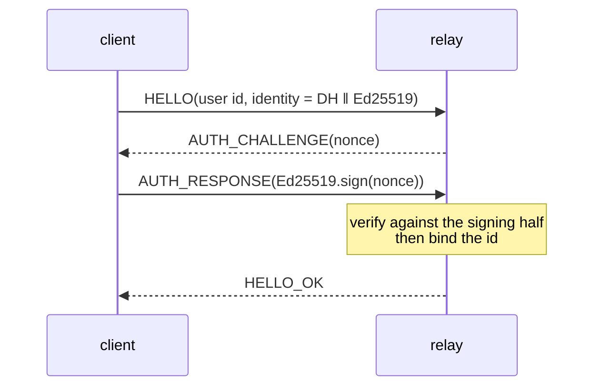

# Protocol

Everything the client and the relay agree on, in one place.

## Envelope

Every websocket message is one frame.

```
[1] version | [1] type | [4] payload length (big endian) | payload
```

Payload fields are length-prefixed except where a fixed width is part of the
format. A frame whose declared length does not match its actual length is
rejected before any field is read, so a malformed frame fails cleanly instead of
producing a partially populated message.

## Message types

| Type | Direction | Purpose |
|---|---|---|
| `HELLO` | client → relay | claim a user id, naming an identity key |
| `AUTH_CHALLENGE` | relay → client | 32-byte nonce the client must sign |
| `AUTH_RESPONSE` | client → relay | Ed25519 signature over that nonce |
| `HELLO_OK` | relay → client | id bound; the connection is usable |
| `PUBLISH_PREKEYS` | client → relay | store the signed prekey and one-time prekeys |
| `GET_BUNDLE` | client → relay | fetch a peer's prekey bundle |
| `BUNDLE` | relay → client | identity, signed prekey, one one-time prekey |
| `SEND` | client → relay | opaque body for a recipient |
| `DELIVER` | relay → client | `[8] sequence \| [sender] \| [body]` |
| `MORE_PENDING` | relay → client | the last page was full; the next ACK pulls more |
| `ACK` | client → relay | `[8]` sequence: drop up to it, pull the next page |
| `ERROR` | relay → client | human-readable rejection |

A live delivery carries sequence `0`; a replayed one carries the real sequence
so the client can acknowledge it.

## Registration is a proof, not a claim

`HELLO` does not bind the user id. The relay answers with a nonce, and the id is
only bound once the client proves it holds the identity signing key by signing
that nonce.



Without this, an unused id is first-come-first-served: anyone can take it and
publish prekeys of their own under it. The nonce is single-use and dies with the
connection; a second `HELLO` on the same socket is refused, so a client cannot
grind nonces without paying for a new socket each time.

## Sequence numbers are per-recipient and 8 bytes

The outbox id is a *dense per-recipient* counter, not a database row identity.

That distinction is load-bearing. A global `AUTOINCREMENT` rowid is sparse from
any one recipient's point of view — it has to acknowledge ids it never received
— and it is 64-bit, so putting it on the wire as 32 bits means it wraps. The
wrap is not theoretical: after it, an acknowledgement can name a row belonging
to somebody else.

A dense counter scoped to the recipient has neither problem, and lets an ACK
mean exactly what it says: "I have everything up to here."

## Replay is paged

A connection with a backlog receives up to 200 entries, then `MORE_PENDING`.
Each `ACK` acknowledges what was consumed and pulls the following page.

The alternative — one page at connect time — strands everything behind the first
page until the next reconnect, with the UI showing an empty conversation and no
hint that more was waiting.

## Delivery is at-least-once

A message can arrive live and then again as a replay out of the outbox. The
ratchet refuses the second copy, and the client is told *why*:

| Outcome | Meaning | What the client does |
|---|---|---|
| `OK` | accepted | show it, ACK if it came from the outbox |
| `DUPLICATE` | already accepted once | ACK silently, say nothing |
| `AUTH_FAILED` | failed on a counter never seen | drop, surface it |
| `TOO_FAR_AHEAD` | counter would blow the skipped-key budget | drop, surface it |
| `NO_SESSION` | no ratchet for this label | drop, surface it |

Collapsing these into a single "decryption failed" made every duplicated
delivery look like an attack.

## Backpressure

- **Sends are paced per connection.** A token bucket, 30 burst, one token per
  10 seconds. Without it one authenticated socket can fill the outbox for
  everybody else.
- **The outbox is bounded.** Entries expire after 7 days; each recipient is
  capped at 2000 entries with the oldest trimmed first; a sweep runs every 15
  minutes and once at shutdown.
- **Slow consumers are disconnected, not buffered.** `enqueue` never blocks.

## Endpoints

| Path | Purpose |
|---|---|
| `/ws` | the relay itself |
| `/healthz` | liveness only — touches nothing, so a slow disk cannot cause a restart |
| `/readyz` | readiness — queue depth, live connections; 503 when the store cannot be written |
| `/health` | alias of `/readyz`, for the container probe and older deployments |

Readiness writes to the store on purpose. A read can succeed against a file that
cannot be written, and a full disk or a read-only mount is exactly what has to
be caught before a deploy is declared healthy.

## One-time prekeys are spent locally, not only at the relay

The relay pops a one-time prekey from its list when it hands it out, which stops
it being offered twice. That is not enough on its own: the *private* half lives
on the device, and without a local record it stays usable, so a replayed first
frame would run X3DH against it a second time.

Every one-time prekey therefore carries a persisted `consumed` flag. A header
naming an already-spent key is refused, and a batch is generated when the unspent
supply drops below half.

## Ratchet frame

```
[1]   flags            bit 0 = carries a prekey header
[200] prekey header    only when the flag is set
[40]  ratchet header   dh public | previous chain length | message number
[n]   ciphertext || 16-byte MAC
```

The prekey header:

```
[32] sender identity DH key
[32] sender identity signing key
[64] binding signature   (signing key over the DH key)
[32] sender ephemeral key
[32] recipient identity DH key
[4]  signed prekey id | [4] one-time prekey id
```

It carries the sender's **whole** identity, not just the DH half, for two
reasons. The binding signature lets the recipient check that the DH key it will
run X3DH against and the signing key it will trust for future prekeys belong to
the same holder. And without the signing half the recipient could never compute
a safety number the sender would agree with, because the sender's own safety
number covers both halves.

It travels with **every** frame until the peer answers. A first frame can be
lost — the socket drops, the outbox entry is discarded, the peer restarts — and
if the header went with it the handshake could never be retried.

The ratchet header is authenticated as associated data, so it cannot be
rewritten in flight.

## Versioning

The envelope has a version byte and it is checked. A relay receiving a version
it does not know rejects the frame rather than guessing. Adding a message type
is backward compatible; changing a field layout is not, and requires the version
to move.
